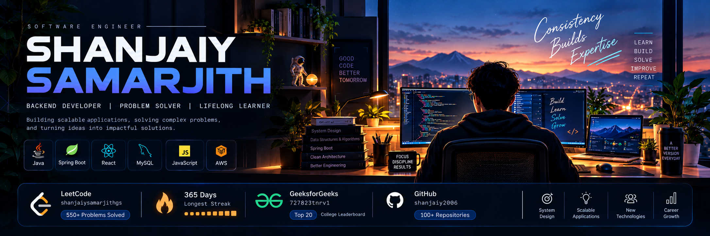

 

# SHANJAIY SAMARJITH

### Software Engineer | Backend Developer | Problem Solver

Building scalable applications. Solving complex problems. Engineering impactful solutions.

---

## ABOUT ME

I'm a final-year B.Tech Information Technology student at Sri Krishna College of Technology, Coimbatore, passionate about software engineering, backend architecture, and problem-solving.

- Backend-focused developer specializing in Java and Spring Boot.
- Experience building full-stack applications and RESTful services.
- Solved 550+ Data Structures and Algorithms problems.
- Achieved a 365-day LeetCode streak.
- Ranked Top 20 on the GeeksforGeeks college leaderboard.
- Built and maintained 100+ GitHub repositories.
- Currently exploring advanced React.js, Dynamic Programming, and System Design.

**My engineering philosophy:** Write clean code, understand fundamentals, build meaningful products, and never stop learning.

---

## TECHNICAL EXPERTISE

| Category | Technologies |
|---|---|
| Languages | Java, SQL, JavaScript |
| Backend | Spring Boot, Spring Security, Hibernate, REST APIs |
| Frontend | React.js, HTML5, CSS3 |
| Database | MySQL |
| Cloud & Deployment | AWS EC2, Render, Vercel |
| Tools | Git, GitHub, Postman, IntelliJ IDEA, VS Code |

---

## FEATURED PROJECTS

### 01. Event Management System
**Java · Spring Boot · React.js · MySQL · JWT · AWS**

A role-based event management platform featuring secure authentication, event organization, QR-based attendance, and automated certificate generation.

- 15+ REST API endpoints.
- Role-based access control.
- QR-code attendance management.
- Automated PDF certificate generation.
- Backend deployed on AWS EC2.

[Repository](https://github.com/shanjaiy2006/Event-Management-System)

### 02. SchemaIQ – AI Data Analyst Agent
**Streamlit · FastAPI · LangGraph · Groq · MySQL · Pandas · Plotly**

An AI-powered data analyst that transforms natural-language questions into actionable insights from structured datasets.

[Live Application](https://schema-iq.streamlit.app/)

### 03. AI ATS Resume Analyzer
**Python · Streamlit · AI**

An intelligent resume analysis application designed to evaluate resumes against job requirements.

[GitHub Repository](https://github.com/shanjaiy2006/AI-Resume-Critiquer) · [Live Demo](https://ats-resume-analyze.streamlit.app/)

### 04. DSA Mastery – DSA Patterns Platform
**React.js · Spring Boot · MySQL · JWT**

A structured learning platform designed to help developers master DSA concepts through organized problem-solving patterns.

### 05. Jewellery Missing Stone Detection
**YOLOv8 · OpenCV · Roboflow**

A computer vision solution focused on detecting missing stones in jewellery images using a custom-trained YOLOv8 model.

### 06. JavaScript Practice & Learnings
**JavaScript · HTML · CSS**

A collection of hands-on JavaScript projects, including a calculator, countdown timer, to-do list, and weather application.

[GitHub Repository](https://github.com/shanjaiy2006/js-practice-learnings)

---

## PROBLEM SOLVING

| Platform | Achievement |
|---|---|
| LeetCode | 550+ DSA problems across platforms |
| LeetCode | 365-day streak badge |
| LeetCode | 200-day, 100-day and 50-day badges |
| GeeksforGeeks | Top 20 college leaderboard |
| GitHub | 100+ repositories |

### LeetCode Statistics & Submission Heatmap

### GeeksforGeeks

---

## GITHUB ANALYTICS

### GitHub Statistics

### Contribution Streak

### Contribution Activity

---

## CURRENTLY EXPLORING

- Advanced JavaScript and React.js.
- Dynamic Programming and advanced DSA.
- System Design and scalable architectures.
- Spring Boot and Microservices.
- Software Engineering best practices.

---

## LET'S CONNECT

Interested in software engineering, backend development, problem-solving, and building impactful products.

[LinkedIn](https://www.linkedin.com/in/shanjaiysamarjithgs/) · [GitHub](https://github.com/shanjaiy2006) · [LeetCode](https://leetcode.com/u/shanjaiysamarjithgs/) · [GeeksforGeeks](https://www.geeksforgeeks.org/profile/727823tnrv1?tab=activity)

**Consistency builds expertise. Curiosity drives innovation.**

⭐ Thanks for visiting my profile!

